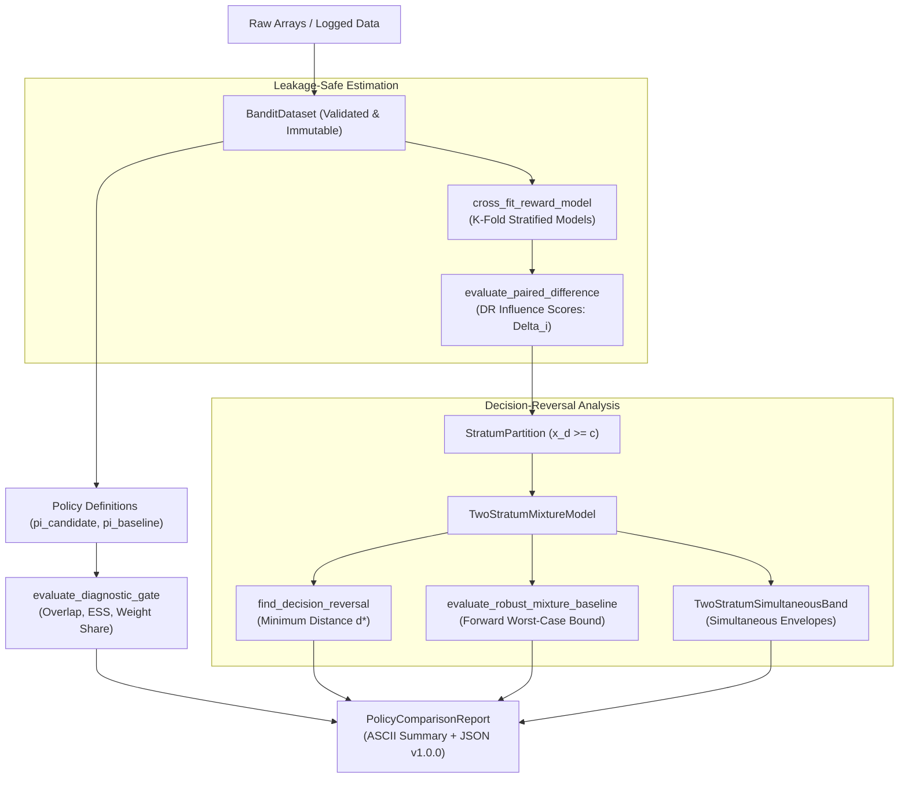

# Architecture

Status: describes the codebase as of Milestone M5A (`0.1.0.dev0`).

## Layering

```
contracts/        validated containers and immutable array checks (no internal dependencies)
   ↑
policies/         Policy protocol, sampling, reference implementations (depends on contracts)
   ↑
data/             synthetic environments and Open Bandit adapter (contracts, policies)
   ↑
evaluation/       estimators (IPS, SNIPS, DM, DR), reward models, K-fold cross-fitting,
                  influence scores, bootstrap, diagnostics, OBP reference bridge
   ↑
reversal/         paired difference estimation, 1-D two-stratum mixture models,
                  analytical & numerical reversal search, simultaneous confidence bands,
                  forward worst-case robust mixture baseline, decision rules, taxonomy
   ↑
api.py            Public Python SDK: BanditDataset, PolicyValueEvaluator,
                  PolicyComparison, PolicyComparisonReport, run_quickstart
   ↑
experiments/      configs, reproducible Monte Carlo runners (Exp 001–007), provenance
   ↑
cli.py            CLI front end (argparse): run-example, validate-estimators,
                  compare-reference, run-reversal, report
```

### Architectural Principles and Separation of Concerns

1. **Strict Immutability:**
   - `LoggedBanditData` and `BanditDataset` enforce read-only arrays (`as_readonly`) and immutable dataclass semantics.
   - Observational tuples $(x_i, a_i, r_i, p_i)$ are validated upon creation (non-empty, matching lengths, $a_i \in [0, K)$, $p_i > 0$, finite context/rewards).

2. **Decoupling Policies, Models, and Estimators:**
   - Estimators (`ips`, `snips`, `dm`, `dr`) are pure, side-effect-free functions.
   - `dm` and `dr` accept pre-computed `(N, K)` predicted rewards. They do not fit models internally.
   - `cross_fit_reward_model` manages out-of-fold sample splitting and cross-fitting to guarantee leakage safety.
   - `evaluation/` never imports `data/` or `policies/`.

3. **Public SDK vs. Internal Research Runners:**
   - `reversallab.api` exposes high-level, production-ready workflows: `BanditDataset`, `PolicyValueEvaluator`, `PolicyComparison`, and structured report exports.
   - Private experiment scripts and Monte Carlo runners in `reversallab.experiments` are internal tools for empirical validation; they are not exposed on the top-level SDK package namespace.

4. **Diagnostic Gating Precedes Inference:**
   - Statistical evaluation is gated by multi-factor diagnostics (`evaluate_diagnostic_gate`).
   - Logging propensity deficits ($p_i < \tau$ on actively evaluated actions), extreme weight concentration ($\max w_i / \sum w_i > 0.20$), or effective sample size collapse ($\text{ESS} / N < 0.05$) fail the diagnostic gate and transition decisions to `INCONCLUSIVE`, preventing spurious `RECOMMEND` actions.

5. **Two-Stratum Perturbation Framework:**
   - Decisions are audited against demographic shift in mixture weights $q \in [0, 1]$ across a context partition $\mathcal{X}_0 = \{x : x_d \ge c\}, \mathcal{X}_1 = \{x : x_d < c\}$.
   - Reversal search finds the minimum perturbation distance $d^* = |q^* - q_0|$ that overturns the baseline decision.
   - Simultaneous confidence bands ($2 \times 95\%$) and forward worst-case robust bounds ($L_{\text{worst}} = \min_{q \in \mathcal{Q}_\epsilon} L(q)$) provide exact finite-envelope certificates.
   - Concavity of the lower confidence bound ensures the worst-case within any closed interval $[q_{\min}, q_{\max}]$ is attained at a boundary endpoint.

---

## Key Public and Internal Interfaces

| Layer | Component | Contract / Signature | Role |
|---|---|---|---|
| **Public SDK** | `BanditDataset` | `from_arrays(contexts, actions, rewards, propensities)` | Public entrypoint for immutable logged bandit data |
| **Public SDK** | `PolicyValueEvaluator` | `evaluate(dataset, policy, estimator, ...)` | Evaluates single policy value with SE, CI, and diagnostics |
| **Public SDK** | `PolicyComparison` | `evaluate(dataset, candidate, baseline, margin, ...)` | Paired comparison, diagnostic gate, decision-reversal audit |
| **Public SDK** | `PolicyComparisonReport` | `summary()`, `to_dict()`, `save(path)` | Ergonomic ASCII display & schema-versioned JSON export |
| **Public SDK** | `run_quickstart` | `run_quickstart(output_path)` | Executable end-to-end reference demo workflow |
| **Contracts** | `LoggedBanditData` | `context, action, reward, logging_propensity, n_actions` | Core immutable data contract |
| **Policies** | `Policy` (Protocol) | `action_distribution(context) -> (N, K)` | Policy distribution generator |
| **Estimators** | `dr`, `dm`, `ips`, `snips` | `(data, eval_dist, [pred_rewards], *, confidence_level)` | Pure OPE estimators |
| **Modeling** | `RewardModel` (Protocol) | `fit(context, action, reward)`, `predict(context) -> (N, K)` | Supervised reward prediction protocol |
| **Cross-Fitting** | `cross_fit_reward_model`| `(data, model_factory, *, n_folds, seed) -> FloatArray` | Leakage-safe K-fold cross-fitted rewards |
| **Reversal** | `TwoStratumMixtureModel` | `create_two_stratum_model(contexts, scores, partition)` | 1-D mixture model with per-stratum stats |
| **Reversal** | `find_decision_reversal`| `(strata_model, margin, max_epsilon, ...)` | Numerical bisection reversal search |
| **Reversal** | `find_analytical_decision_reversal` | `(strata_model, margin, max_epsilon, ...)` | Analytical root-finding reference search |
| **Reversal** | `evaluate_robust_mixture_baseline` | `(strata_model, margin, deploy_epsilon, ...)` | Forward worst-case robust mixture baseline |
| **Diagnostics** | `evaluate_diagnostic_gate` | `(data, cand_dist, base_dist, thresholds)` | Multi-factor operational validity gate |

---

## Data Flow



---

## Design Scope and Deliberate Boundaries

The following components are **deliberately excluded** from the current core engine:
- **No Multidimensional Blackbox Optimization:** The reversal engine explicitly focuses on 1-D demographic mixture shifts where concavity and analytical roots provide exact, auditable guarantees without local-minimum traps.
- **No Complex Neural Network Dependencies:** Reward models default to scikit-learn action-stratified linear and logistic models to maintain fast, deterministic, leakage-safe cross-fitting.
- **No Web Frameworks or Cloud Infrastructure:** No FastAPI, React, Docker, Kubernetes, or cloud database dependencies. The core library is lightweight, fast, and runs locally.
