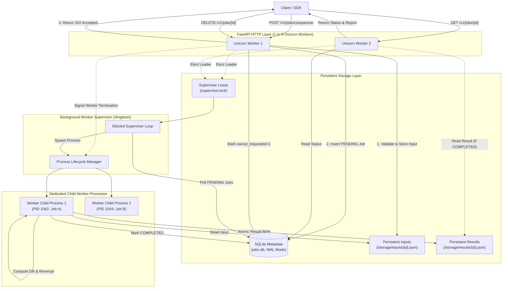
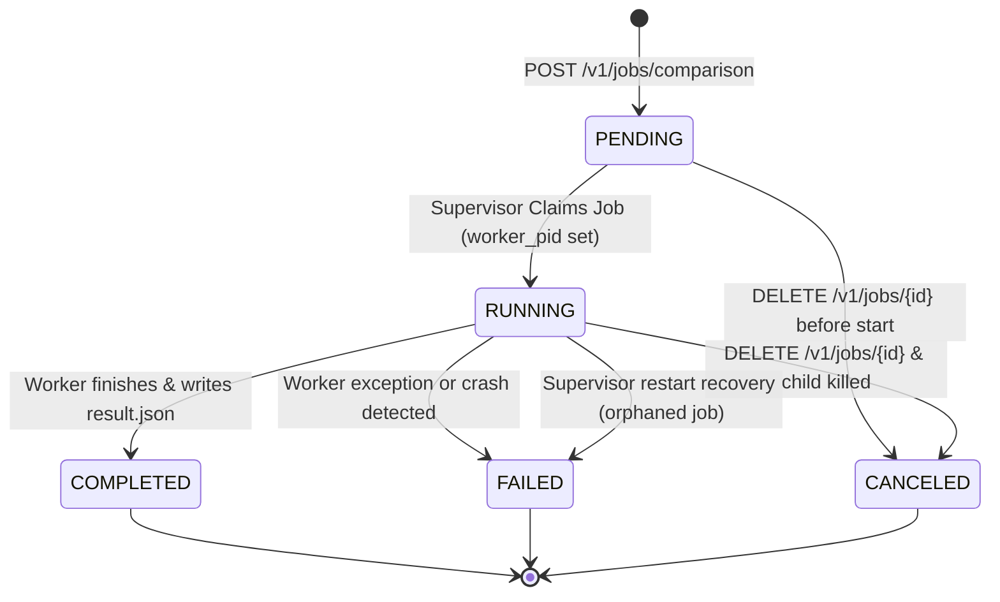

# ReversalLab — Asynchronous Job Processing Architecture Specification

> **Milestone**: M6B-2B  
> **Status**: Approved Architecture  
> **Domain**: Persistent Bounded Off-Policy Evaluation & Decision-Reversal Engine

---

## 1. System Overview & Core Philosophy

The ReversalLab evaluation service provides two execution paths for off-policy contextual bandit evaluation and decision-reversal search:

1. **Synchronous HTTP Pipeline (`POST /v1/evaluate/comparison`)**:
   Designed for low-latency interactive requests ($N \le 25{,}000$, execution $< 400\text{ ms}$). Requests run directly in worker threadpools under strict admission budgets ($N \times D \times K \times \text{folds} \le 10{,}000{,}000$).
2. **Persistent Bounded Asynchronous Job Engine (`POST /v1/jobs/comparison`, `GET /v1/jobs/{job_id}`, `DELETE /v1/jobs/{job_id}`)**:
   Designed for long-running, CPU-intensive statistical evaluations ($N > 25{,}000$, high-resolution reversal grid scans, or heavy cross-fitting). 

### Architectural Tenets
- **Minimal Dependencies**: Zero external message brokers (no Redis, RabbitMQ, Kafka, or Celery). Operates self-contained inside the single-node deployment.
- **Persistence & Durability**: Job metadata is tracked transactionally in SQLite (WAL mode). Inputs and outputs are written atomically to a persistent local filesystem storage directory.
- **Single Supervisor Ownership**: Regardless of how many Uvicorn ASGI workers serve HTTP traffic, exactly **one** supervisor actively polls, dispatches, and manages child worker processes.
- **Isolated Process Execution & Targeted Cancellation**: Each active background job runs in a dedicated child worker process. Canceling a running job terminates its specific child process without interrupting concurrent jobs or corrupting the main ASGI service.
- **Crash Recovery & At-Most-Once Semantics**: System restarts detect orphaned jobs and transition them cleanly to terminal states without unbounded poison-pill retry loops.

---

## 2. Architecture & Data Flow



---

## 3. Job State Machine

The lifecycle of every job follows a strictly defined finite state machine. Transitions occur atomically via transactional SQLite updates.



### Transition Matrix & Invariants

| From State | To State | Trigger Event | Guard / Conditions | Post-Actions |
| :--- | :--- | :--- | :--- | :--- |
| `[None]` | `PENDING` | `POST /v1/jobs/comparison` | Payload valid, admission queue not full, storage under quota. | Input written to disk atomically; job row inserted. |
| `PENDING` | `RUNNING` | Supervisor dispatch | Available worker slot ($C_{active} < W_{max}$). | `worker_pid` recorded, `started_at` set. Child spawned. |
| `PENDING` | `CANCELED` | `DELETE /v1/jobs/{id}` | Job is in `PENDING` state. | Set `status = 'CANCELED'`, `completed_at = now()`. |
| `RUNNING` | `COMPLETED` | Worker exit code 0 | Result file valid on disk. | Set `status = 'COMPLETED'`, `completed_at = now()`. |
| `RUNNING` | `FAILED` | Worker exit code $\ne 0$ or unhandled error | Process exited with error or exception. | Set `status = 'FAILED'`, record `error_code` and message. |
| `RUNNING` | `CANCELED` | `DELETE /v1/jobs/{id}` | Target child process terminated. | Terminate `worker_pid`, set `status = 'CANCELED'`. |
| `RUNNING` | `FAILED` | Supervisor crash recovery | Process PID no longer exists on startup. | Set `error_code = 'CRASH_OR_RESTART_DETECTED'`. |

---

## 4. Concurrency, Locking & Supervisor Single-Ownership

### The Multi-Worker Uvicorn Challenge
When Uvicorn runs with multiple worker processes (e.g. `--workers 4`), each process executes FastAPI application lifespan startup events. If every worker ran a dispatcher loop, multiple dispatchers would compete to claim jobs, causing race conditions, split-brain PID tracking, and over-subscription of CPU resources.

### Solution: File-Based Leader Election (`supervisor.lock`)
1. On application startup, each Uvicorn worker attempts to acquire an exclusive, non-blocking lock on `<storage_dir>/supervisor.lock`.
2. The worker that successfully acquires the lock becomes the **Active Supervisor**.
3. Other workers detect that the lock is held, log `Supervisor lock held by peer worker; running in API-only mode`, and skip supervisor loop execution.
4. If the active supervisor process terminates unexpectedly, the OS automatically releases the file lock, allowing another worker or a new process to acquire the supervisor role.

### SQLite WAL Mode & Concurrency
- `PRAGMA journal_mode = WAL;` (Write-Ahead Logging enables concurrent readers during writes).
- `PRAGMA busy_timeout = 5000;` (Prevents `sqlite3.OperationalError: database is locked` during bursts).
- `PRAGMA synchronous = NORMAL;` (Provides power-failure durability with high write throughput).
- **Atomic Job Claim Query**:
  ```sql
  UPDATE jobs 
  SET status = 'RUNNING', started_at = ?, worker_pid = ? 
  WHERE job_id = ? AND status = 'PENDING';
  ```
  Only the process where `changes() == 1` proceeds with child execution.

---

## 5. Storage Layout & Ephemeral Container Boundaries

### Directory Structure
```text
<storage_root>/
├── jobs.db              # SQLite metadata database (WAL mode)
├── supervisor.lock      # Leader-election advisory lockfile
├── inputs/
│   ├── <job_id>.json    # Immutable validated request payload
├── results/
│   ├── <job_id>.json    # Immutable final PolicyComparison report
└── tmp/
    ├── <job_id>.tmp.<pid> # Staging file for atomic rename
```

### Security & Integrity Controls
1. **Path Traversal Protection**: All `job_id` parameters are validated against strict UUID4 format (`^[0-9a-f]{8}-[0-9a-f]{4}-4[0-9a-f]{3}-[89ab][0-9a-f]{3}-[0-9a-f]{12}$`). Relative paths (`../`) are rejected immediately with HTTP 422.
2. **Atomic Writes**: Result files are written to `tmp/<job_id>.tmp.<pid>`, flushed with `os.fsync`, and atomically replaced into `results/<job_id>.json` via `os.replace`.
3. **Storage Quota Enforcement**: If the storage directory exceeds `MAX_STORAGE_MB` (default: 200 MB), new job submissions are rejected with HTTP 422 / 507 before writing to disk.
4. **Queue Capacity Limit**: If active `PENDING` jobs exceed `MAX_QUEUED_JOBS` (default: 50), submissions are rejected with HTTP 429 / 503.
5. **Data Privacy**: Contexts, actions, rewards, and propensities are NEVER emitted in server logs or Prometheus metrics. Only `job_id`, `payload_hash[:12]`, and execution durations are logged.
6. **Docker Durability Warning**:
   > [!IMPORTANT]
   > SQLite and disk-based job persistence requires a mounted host directory or persistent Docker volume (e.g. `docker run -v /var/data/reversallab:/data ...`). Storage within an ephemeral container layer will be destroyed upon container deletion or replacement.

---

## 6. Targeted Cancellation Mechanism

Standard `concurrent.futures.ProcessPoolExecutor.Future.cancel()` fails to terminate a task once it transitions to running in Python 3.11/3.12.

### ReversalLab Child-Process Ownership Pattern
1. When the Supervisor dispatches a job, it spawns a dedicated child process:
   ```python
   proc = subprocess.Popen(
       [
           sys.executable,
           "-m",
           "reversallab.service.worker",
           "--job-id",
           job_id,
           "--input-path",
           input_path,
           "--result-path",
           result_path,
           "--db-path",
           db_path,
       ]
   )
   ```
2. The supervisor records `proc.pid` in memory and persists it to the `jobs` SQLite row.
3. Upon receiving `DELETE /v1/jobs/{job_id}`:
   - The supervisor (or API endpoint) retrieves `proc.pid`.
   - Sends termination signal (`proc.terminate()` on POSIX, `TerminateProcess` on Windows).
   - Waits up to 3.0 seconds for clean child exit (`proc.wait()`), falling back to `proc.kill()` if necessary.
   - Cleans up partial temporary files.
   - Transitions database state to `CANCELED`.
4. **Guarantees**:
   - Running child process is guaranteed dead before HTTP 200/202 is returned to the client.
   - Unrelated concurrent jobs running in separate child processes are unaffected.
   - All memory allocated by the child is immediately reclaimed by the OS.

---

## 7. Crash Recovery & Execution Semantics

### Execution Semantics: At-Most-Once with Idempotency
- ReversalLab implements **at-most-once** execution semantics for background jobs.
- If a server crashes while a job is `RUNNING`, the job is NOT automatically re-executed on restart because the crash may have been caused by a memory exhaustion poison pill.
- Recovery upon startup marks orphaned `RUNNING` jobs as `FAILED` with error code `CRASH_OR_RESTART_DETECTED`.
- If a client resubmits an identical request with an idempotency key or matching payload hash, the service returns the existing terminal status or allows a fresh submission if previously failed.

---

## 8. Resource Budgets

| Parameter | Synchronous API | Background Job Engine |
| :--- | :--- | :--- |
| **Max Compute Budget ($N \cdot D \cdot K \cdot \text{folds}$)** | $10{,}000{,}000$ | $50{,}000{,}000$ |
| **Max Payload Size** | 10 MB | 10 MB |
| **Max Concurrent Execution** | Dynamic (GIL / Threadpool) | Fixed Bounded Workers ($W \le 2$) |
| **Max Queued Pending Jobs** | Unbounded (Socket Backlog) | Strict Bound (Max 50) |
| **Max Job Execution Timeout** | None (Client socket timeout) | Strict 300 seconds (5 min) |
| **Max Storage Usage** | 0 MB (In-memory) | 200 MB (Hard Quota) |
| **Retention Period** | Ephemeral | 24 Hours (Purged automatically) |
