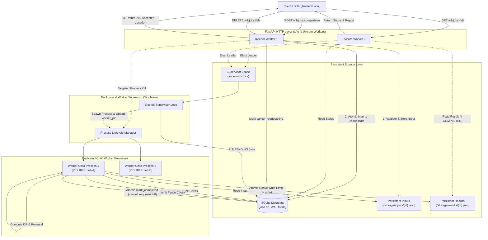
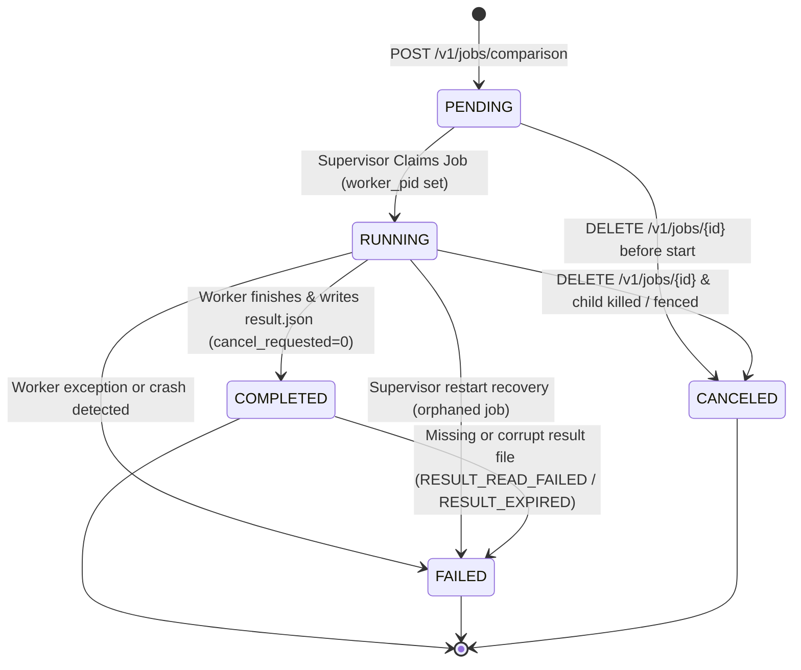

# ReversalLab — Asynchronous Job Processing Architecture Specification

> **Milestone**: M6C  
> **Status**: Verified & Hardened Architecture  
> **Domain**: Persistent Bounded Off-Policy Evaluation & Decision-Reversal Engine

---

## 1. System Overview & Core Philosophy

The ReversalLab evaluation service provides two execution paths for off-policy contextual bandit evaluation and decision-reversal search:

1. **Synchronous HTTP Pipeline (`POST /v1/evaluate/comparison`)**:
   Designed for low-latency interactive requests ($N \le 25{,}000$, execution $< 400\text{ ms}$). Requests run directly in worker threadpools under strict admission budgets ($N \times D \times K \times \text{folds} \le 10{,}000{,}000$).
2. **Persistent Bounded Asynchronous Job Engine (`POST /v1/jobs/comparison`, `GET /v1/jobs/{job_id}`, `DELETE /v1/jobs/{job_id}`)**:
   Designed for long-running, CPU-intensive statistical evaluations ($N > 25{,}000$, high-resolution reversal grid scans, or heavy cross-fitting) with budgets up to $50{,}000{,}000$.

### Architectural Tenets
- **Minimal Dependencies**: Zero external message brokers (no Redis, RabbitMQ, Kafka, or Celery). Operates self-contained inside the single-node deployment.
- **Persistence & Durability**: Job metadata is tracked transactionally in SQLite (WAL mode). Inputs and outputs are written atomically to a persistent local filesystem storage directory.
- **Single Supervisor Ownership**: Regardless of how many Uvicorn ASGI workers serve HTTP traffic, exactly **one** supervisor actively polls, dispatches, and manages child worker processes.
- **Isolated Process Execution & Targeted Cancellation**: Each active background job runs in a dedicated child worker process. Canceling a running job terminates its specific child process without interrupting concurrent jobs or corrupting the main ASGI service.
- **Crash Recovery & At-Most-Once Semantics**: System restarts detect orphaned jobs and transition them cleanly to terminal states without unbounded poison-pill retry loops.

---

## 2. Deployment Model & Security Boundary (Model A)

### Explicit Deployment Model: Model A (Trusted Single-User / Local Deployment Only)
ReversalLab's background job engine is strictly designed and certified for **Model A**:
- **Single-Tenant / Local Boundary**: The service assumes all clients interacting with the API are trusted entities within the same local boundary (e.g. localhost, local developer machine, or dedicated container environment).
- **No User Isolation or Authentication**: The engine does NOT enforce multi-tenant isolation, user identity, or tenant-scoped authorization.
- **Job IDs and Payload Hashes are NOT Credentials**: The RFC 4122 UUID4 `job_id` and SHA-256 `payload_hash` are operational routing and tracking identifiers. They do NOT confer authentication or authorization. Anyone with network access to the API who knows or discovers a `job_id` can query its status, download its evaluation report, or request its cancellation.
- **Network Exposure Rules**:
  - The service MUST NOT be exposed directly to the public internet or untrusted networks without an external authenticating reverse proxy (e.g. Envoy, NGINX, Cloudflare Access) or VPN.
  - By default, local server deployments should bind exclusively to loopback (`127.0.0.1` / `::1`).
  - CORS origins should be restricted to trusted domains via `REVERSALLAB_CORS_ORIGINS`.
- **Filesystem Permissions**:
  - On POSIX filesystems, storage directories (`inputs/`, `results/`, `tmp/`) are initialized with restricted permissions (`0700`) and payload files with `0600`.
  - In Docker containers, the service executes under a dedicated non-root user (`reversallab:reversallab`, UID/GID 10001).

---

## 3. Architecture & Data Flow



---

## 4. Job State Machine & Transition Invariants

The lifecycle of every job follows a strictly defined finite state machine. Transitions occur atomically via transactional SQLite updates.



### Transition Matrix & Invariants

| From State | To State | Trigger Event | Guard / Conditions | Post-Actions |
| :--- | :--- | :--- | :--- | :--- |
| `[None]` | `PENDING` | `POST /v1/jobs/comparison` | Payload valid, admission queue not full ($< 50$), storage under quota ($< 200\text{ MB}$). | Input written atomically; job row inserted in SQLite transaction. |
| `PENDING` | `RUNNING` | Supervisor dispatch | Available worker slot ($C_{active} < 2$). | `started_at` set, child spawned, real OS `worker_pid` recorded. |
| `PENDING` | `CANCELED` | `DELETE /v1/jobs/{id}` | Job is in `PENDING` state. | Set `status = 'CANCELED'`, `completed_at = now()`, remove input file. |
| `RUNNING` | `COMPLETED` | Worker exit code 0 | Result file valid on disk AND `cancel_requested = 0`. | Set `status = 'COMPLETED'`, `completed_at = now()`. |
| `RUNNING` | `FAILED` | Worker exit code $\ne 0$ or unhandled error | Process exited with error or exception. | Set `status = 'FAILED'`, record `error_code` and message. |
| `RUNNING` | `CANCELED` | `DELETE /v1/jobs/{id}` | Child process terminated via SIGTERM/SIGKILL or worker fence (exit code 2). | Verified process dead, set `status = 'CANCELED'`, delete partial files. |
| `RUNNING` | `FAILED` | Supervisor crash recovery | Process orphaned on supervisor startup. | Safe zombie process termination, set `error_code = 'CRASH_OR_RESTART_DETECTED'`. |
| `COMPLETED`| `FAILED` | Result read failure | Result file deleted or contains corrupt JSON. | Transitions to `FAILED` (`RESULT_READ_FAILED` or `RESULT_EXPIRED`). |
| `COMPLETED`| `[No-op]` | `DELETE /v1/jobs/{id}` | Job already in terminal state. | Rejects with HTTP 409 Conflict; state is immutable. |

---

## 5. Idempotency Specification & Race Elimination

### Canonical Content Hashing
1. **Serialization**: Inbound request dictionaries are serialized to bytes using RFC 8785 canonical JSON formatting:
   `json.dumps(payload_dict, sort_keys=True, separators=(",", ":")).encode("utf-8")`.
2. **Hash Key**: A SHA-256 digest is computed from the canonical bytes (`payload_hash`).

### Atomic Reservation Transaction
To prevent race conditions where two identical payloads are submitted concurrently:
- The repository executes `BEGIN IMMEDIATE;` on the SQLite connection.
- It queries `SELECT * FROM jobs WHERE payload_hash = ? AND status IN ('PENDING', 'RUNNING', 'COMPLETED')`.
- If an active job already exists, the transaction commits immediately and returns `(existing_record, False)`. The web handler discards the staged duplicate input file and returns `202 Accepted` pointing to the existing job.
- If no active job exists, it inserts the record within the same transaction and returns `(new_record, True)`.

### Re-evaluation After Terminal States
- **Failed or Canceled Jobs**: If a prior job with the same payload hash is in `FAILED` or `CANCELED` status, it is NOT considered active. Resubmitting will create and execute a fresh evaluation job.
- **Expired / Purged Results**: If a prior job was `COMPLETED`, but its output file was purged from disk (>24h retention or manual cleanup), the engine detects the missing file, marks the historical record `RESULT_EXPIRED`, and admits a fresh evaluation job.
- **Semantic Contract**: The engine provides **at-most-once execution** with opportunistic deduplication. It does NOT promise distributed exactly-once semantics.

---

## 6. Cancellation Guarantees & Two-Phase Worker Fencing

### Two-Phase Process Fencing
Python's `concurrent.futures.ProcessPoolExecutor.Future.cancel()` cannot interrupt a task that has already begun execution. ReversalLab implements explicit two-phase process fencing in `src/reversallab/service/worker.py`:
1. **Phase 1 (Pre-Execution Fence)**: Before loading datasets and policies, the child worker process queries `jobs.db`. If `cancel_requested == 1` or `status != 'RUNNING'`, it immediately aborts with exit code 2.
2. **Phase 2 (Pre-Commit Fence)**: After `PolicyComparison.evaluate` finishes heavy matrix multiplications, the child worker queries `jobs.db` again before replacing the result file. If `cancel_requested == 1`, it immediately deletes any temporary files, leaves `results/<job_id>.json` untouched, and exits with code 2.
3. **Atomic State Transition**: `JobRepository.mark_completed` executes:
   ```sql
   UPDATE jobs
   SET status = 'COMPLETED', completed_at = ?
   WHERE job_id = ? AND status = 'RUNNING' AND cancel_requested = 0;
   ```
   If a cancellation request arrived right as the worker was finishing, `mark_completed` fails (`rowcount == 0`). The worker detects this, unlinks the result file, and exits with code 2.

### Process Termination Verification
When `DELETE /v1/jobs/{job_id}` is invoked:
- The supervisor sends `proc.terminate()` to the dedicated child process.
- It blocks on `proc.wait(timeout=2.0)` to verify actual OS process exit.
- If the child process does not exit within 2 seconds, it escalates to `proc.kill()` and waits 1.0 second.
- Only after the OS confirms process termination is the database updated to `CANCELED` and HTTP 200 returned.
- Sibling worker processes running concurrent evaluations are completely unaffected.

---

## 7. Supervisor Leadership, Process Fencing & Durability

### Multi-Worker Leader Election (`supervisor.lock`)
- Single-node deployments often run multiple Uvicorn worker processes (e.g. `--workers 2`).
- Each worker executes FastAPI lifespan handlers. On startup, each process attempts non-blocking advisory file locking on `<storage_dir>/supervisor.lock` (using `msvcrt.locking` on Windows, `fcntl.flock` on POSIX).
- The process that acquires the lock runs the supervisor dispatch and reaper loop.
- Sibling processes log `Supervisor lock held by peer worker; running in API-only mode` and act purely as HTTP frontends.
- If the leader process crashes, the operating system kernel automatically releases the advisory file lock.

### Safe Zombie Worker Termination on Startup
If a supervisor process crashes while a child worker is mid-computation:
- The replacement supervisor starts up and acquires `supervisor.lock`.
- It invokes `_safe_terminate_orphan_pid` for all jobs found in `RUNNING` status with a recorded `worker_pid`.
- To avoid killing unrelated system processes if the OS recycled the PID, the supervisor inspects the process command line (via `/proc/{pid}/cmdline` on Linux or `psutil` on Windows) to verify that it is genuinely a Python process running `reversallab.service.worker` with `--job-id {job_id}`.
- If verified, the zombie process is terminated.
- `recover_orphaned_jobs()` then transitions the database status to `FAILED` with error code `CRASH_OR_RESTART_DETECTED`.

---

## 8. Storage Consistency Invariants

1. **Atomic File Staging**: All writes to inputs and results use temporary staging files in `<storage>/tmp/` with `.tmp` suffixes, followed by `os.fsync` and atomic `os.replace`.
2. **Transaction Rollback Protection**: If SQLite database insertion fails (e.g. disk error or constraint violation), the staged input file is immediately unlinked, preventing orphaned input files on disk.
3. **Storage Quota Enforcement**: Hard 200 MB limit on persistent storage. Admissions that would exceed the quota are rejected with HTTP 507 Insufficient Storage.
4. **Pruning of Stale Files**: Periodic supervisor cleanup purges terminal records and files older than 24 hours (86,400s), and prunes orphaned temporary staging files in `tmp/` older than 30 minutes (1,800s).

---

## 9. Container Deployment Contract

> [!CAUTION]
> **Persistent Volume Required**: Docker container filesystems are ephemeral. Any container restart or replacement without a persistent volume will destroy `jobs.db` and all completed evaluation reports.
>
> Production deployments MUST mount a dedicated persistent volume to `/home/reversallab/storage/jobs`:
> ```bash
> docker run -d \
>   --name reversallab-service \
>   -p 127.0.0.1:8000:8000 \
>   -v reversallab_data:/home/reversallab/storage/jobs \
>   reversallab-service:latest
> ```
> Notice that the host binding is explicitly restricted to `127.0.0.1:8000:8000` under Model A.

---

## 10. Operational Capacity & Resource Budgets

| Parameter | Synchronous API | Background Job Engine |
| :--- | :--- | :--- |
| **Max Compute Budget ($N \cdot D \cdot K \cdot \text{folds}$)** | $10{,}000{,}000$ | $50{,}000{,}000$ |
| **Max Request Payload Size** | 10 MB | 10 MB |
| **Max Concurrent Workers** | Dynamic (ASGI Threadpool) | Strictly Bounded ($W = 2$) |
| **Max Queued Pending Jobs** | Unbounded Socket Backlog | Strict Admission Limit (50 jobs) |
| **Execution Timeout** | Client Socket Timeout | Strict 300 seconds (Reaped automatically) |
| **Storage Hard Quota** | None (In-memory) | 200 MB |
| **Data Retention** | Ephemeral | 24 Hours (Automatic purge) |
| **Process Startup Baseline** | 0 ms | $\approx 970\text{--}1{,}000\text{ ms}$ |
| **Pure Evaluation Time ($N=2500$)** | $\approx 22\text{ ms}$ | $\approx 22\text{ ms}$ |
| **Cancellation Confirmation Latency** | N/A (Cannot cancel in-flight) | $\text{p50} = 58.34\text{ ms}, \text{p95} = 73.07\text{ ms}$ |
